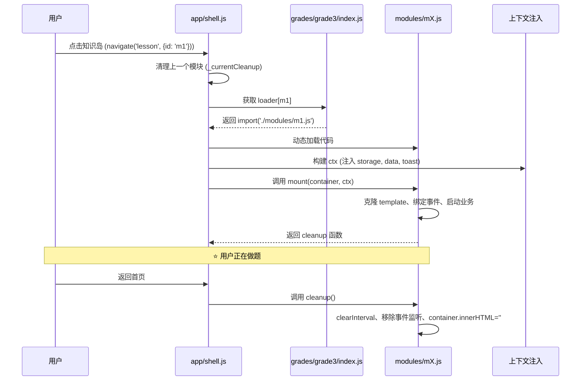
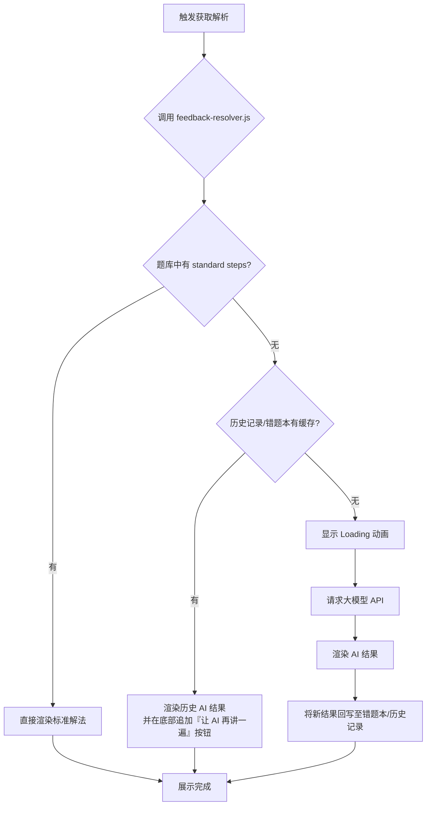
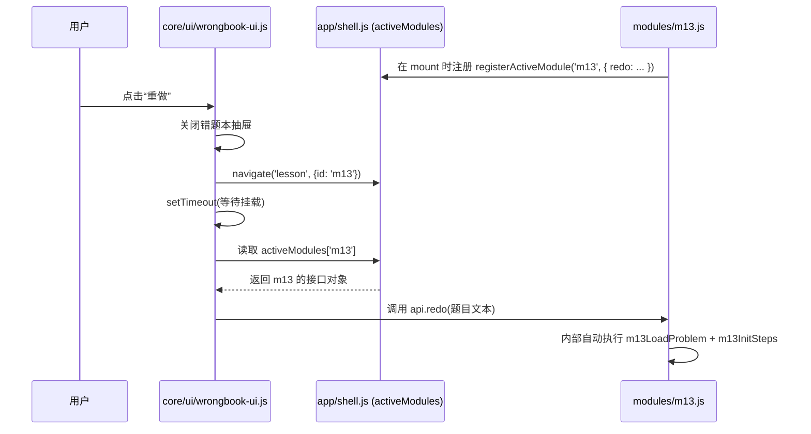
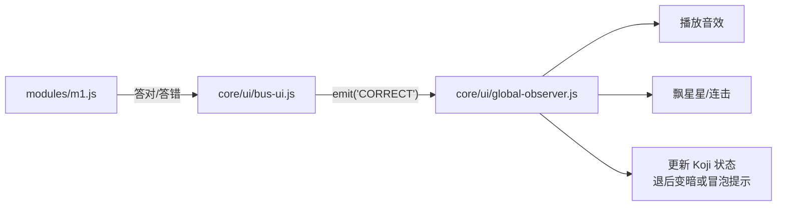
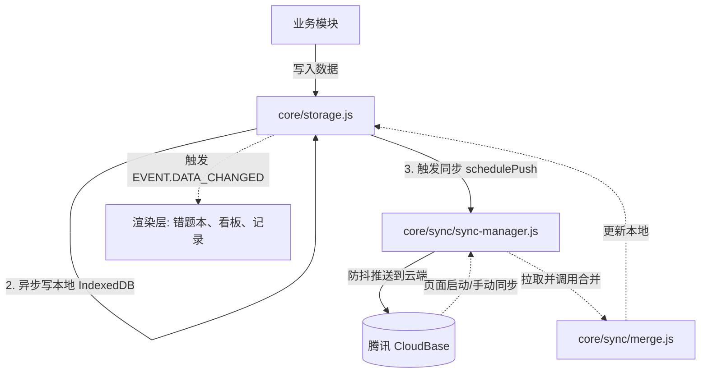

# 三年级数学互动课堂 · 架构重构与系统交互说明书

本文档详细记录了项目从“单体巨石架构”重构为“现代化 ES Module 架构”后的**完整目录结构**、**核心模块职能**以及**数据与交互的流转关系**。

---

## 一、 完整目录结构（Directory Structure）

重构后，项目按“功能职责”与“业务领域”进行了严格的物理分层：

```text
📦 项目根目录
 ┣ 📂 app/                        # 🚀 应用层（启动、路由与全局 UI）
 ┃ ┣ 📜 main.js                  # 启动入口（依赖注入、全局弹窗初始化、页面生命周期）
 ┃ ┣ 📜 shell.js                 # 路由中心（页面切换、模块动态挂载、活动注册表）
 ┃ ┣ 📜 sync-ui.js               # 云端同步状态指示器
 ┃ ┗ 📜 sync-setup-ui.js         # 云端配置与登录弹窗
 ┣ 📂 grades/                     # 🎓 业务层（按年级隔离的具体知识点）
 ┃ ┣ 📜 registry.js              # 年级注册中心（支持未来 4、5、6 年级扩展）
 ┃ ┗ 📂 grade3/                  # 三年级业务
 ┃   ┣ 📜 index.js               # 三年级入口（知识岛配置、模块懒加载路由表）
 ┃   ┣ 📂 modules/               # ⭐ 知识岛模块（m1 ~ m13，彼此完全隔离）
 ┃   ┃ ┣ 📜 m1.js                # 混合运算
 ┃   ┃ ┣ 📜 m2.js                # 铺地砖
 ┃   ┃ ┣ ... 
 ┃   ┃ ┣ 📜 m13.js               # 解题思维
 ┃   ┗ 📂 scoring/               # 纯计算逻辑（无 DOM 依赖）
 ┃     ┣ 📜 m1.js                # 解析算式、运算优先级
 ┃     ┣ 📜 m9.js                # 竖式答案生成
 ┃     ┗ 📜 m13.js               # 应用题数字提取、校验
 ┗ 📂 core/                       # 🧠 核心层（基础设施与通用服务）
   ┣ 📂 ui/                       # 全局 UI 组件与交互补丁
   ┃ ┣ 📜 wrongbook-ui.js         # 错题本抽屉 UI、重做调度、讲解弹窗
   ┃ ┣ 📜 global.js               # 基础 UI 补丁（键盘避让、折叠面板、离线横幅）
   ┃ ┣ 📜 global-observer.js      # 全局事件订阅（答题连击、音效、Koji 状态）
   ┃ ┣ 📜 bus-ui.js               # UI 事件总线（解耦业务与全局特效）
   ┃ ┣ 📜 celebrate.js            # 星星、彩带、连击横幅
   ┃ ┣ 📜 mastery-card.js         # “已掌握”成就卡弹窗
   ┃ ┗ 📜 ai-insight.js           # 大模型反馈面板（strengths/gaps 等）
   ┣ 📂 sync/                     # 数据同步引擎
   ┃ ┣ 📜 sync-manager.js         # 同步状态机、错误退避重试
   ┃ ┣ 📜 cloudbase-adapter.js    # 腾讯云 CloudBase 读写适配
   ┃ ┣ 📜 auth.js                 # 匿名/邮箱登录管理
   ┃ ┗ 📜 merge.js                # 本地与云端数据冲突合并 (LWW)
   ┣ 📜 feedback-resolver.js      # ⭐ 统一查缓存引擎（题库 -> 历史 -> 错题本）
   ┣ 📜 history-render.js         # 做题记录列表渲染、分页、时间轴
   ┣ 📜 wrongbook-render.js       # 错题本列表渲染、智能推荐、标签
   ┣ 📜 dashboard-render.js       # 学习看板渲染（曲线、打卡树）
   ┣ 📜 storage.js                # 存储底层适配（内存 + localForage + 同步推拉）
   ┣ 📜 history.js                # 做题记录 CRUD
   ┣ 📜 wrongbook.js              # 错题本 CRUD 与重做算法
   ┣ 📜 mastery.js                # 掌握度统计
   ┣ 📜 llm.js                    # 大模型 API 封装
   ┗ 📜 ...
```

---

## 二、 核心模块职能说明

### 1. 应用层 (`app/`)
- **`main.js`**：拒绝任何具体业务逻辑。只做三件事：初始化本地存储、启动全局监听器（`installGlobalUI`）、注入错题本/题库等全局弹窗依赖。
- **`shell.js`**：所有路由和页面切换的唯一入口。提供模块的生命周期调度（`mountLesson`），维护 `activeModules` 注册表，供跨模块通讯。

### 2. 业务层 (`grades/grade3/modules/`)
- 每个 `mX.js` 都是一个独立的生命周期组件，必须暴露 `meta`（元数据）和 `mount(container, ctx)`。
- 内部使用的所有 DOM 查询均基于 `container.querySelector`，彻底杜绝污染全局。
- 在 `mount` 结束时，**必须返回 `cleanup` 清理函数**（清空定时器、卸载全局监听）。

### 3. 核心层 (`core/`)
- **`feedback-resolver.js`**：系统的“最强大脑”。无论是错题本讲解、Koji 提示、还是 M13 现算，都先交由它执行 `题库 -> 历史缓存 -> 错题本缓存` 的三级查询。
- **`sync-manager.js`**：负责与云端的数据交互。采用指数退避处理网络错误，配合 `storage.js` 实现静默推拉。

---

## 三、 系统交互与数据流转图

以下展示了应用各个部分是如何协同工作的：

### 交互链路 1：模块加载与卸载（生命周期流转）


### 交互链路 2：判卷与 AI 降级查询（缓存与 AI 链路）

无论用户在哪里触发了“看答案/讲解”（M13 点击检查、错题本点击讲解、点击 Koji 助手），流转链路均如下：



### 交互链路 3：错题本重做（跨模块调度）

原版重做依赖全局操作 DOM，新版通过**模块注册表**实现优雅解耦。



### 交互链路 4：全局答题感知（Koji 状态与音效）

模块内部不直接修改 Koji 或播放音效，而是通过事件总线广播。



### 交互链路 5：云同步与本地存储（数据落盘）



---

## 四、 核心数据流向约定

1. **单向数据流**：模块**绝不**自己手动去改错题本的 DOM 或刷新看板。模块只负责写入本地数据（通过 `ctx.data.historyAdd` 等），底层会触发 `EVT.DATA_CHANGED`，对应的渲染组件（`wrongbook-render.js` 等）收到事件后自动重绘。
2. **绝对禁止的代码**：
   - 严禁在 `mX.js` 中使用 `window.xxx = ...` 污染全局。
   - 严禁使用 `document.getElementById('m1xxx')`，必须使用作用域内的 `container.querySelector()`。
   - 严禁在 `mount` 内部创建全局的 `setInterval` 却不在 `cleanup` 中清理。

---

## 五、 开发与接入规范（给后续迭代者的指南）

### 1. 增加一个新模块 (`m14`)
1. **`index.html`**：在底部添加 `<template id="tpl-m14">`。
2. **`grades/grade3/index.js`**：在 `modules` 对象中添加 `m14: () => import('./modules/m14.js')`。
3. **`grades/grade3/modules/m14.js`**：编写 `meta` 与 `mount(container, ctx)` 并返回 `cleanup`。
4. **接入错题本重做**：在 `m14.js` 内调用 `registerActiveModule('m14', { redo: ... })`。
5. **接入答题特效**：在判卷成功/失败处调用 `emitUI('CORRECT', { moduleId: 'm14' })` 和 `emitUI('WRONG', ...)`。

### 2. 如何让新模块的数据体现在首页？
不用去改 `shell.js`。直接调用 `ctx.data.historyAdd()` 或 `ctx.data.masteryRecord()`，数据层会自动触发广播，首页看板、学习记录、周报等会自动通过 `EVT.DATA_CHANGED` 重新渲染。