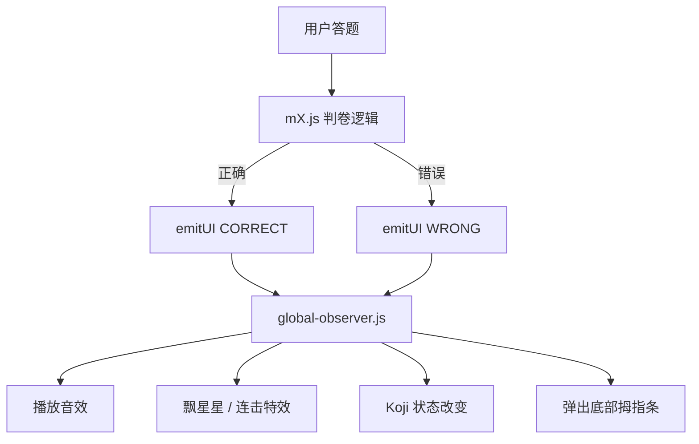

我为你准备了**全新版本的《三年级数学互动课堂 · 产品架构与系统交互说明书》**，你可以直接全选复制，保存为 `ARCHITECTURE.md` 放入项目根目录。

---

# 三年级数学互动课堂 · 产品架构与系统交互说明书 (v1.2)

## 一、 架构设计目标
本项目已从初期的“单文件巨石应用 (Monolith)”重构为 **高内聚、低耦合、按需加载** 的现代化 ES Module 架构。
- **极速首屏**：`main.js` 仅保留启动逻辑（< 100 行），知识点模块完全懒加载。
- **彻底解耦**：各知识岛（m1~m14）内部逻辑完全隔离，互不干扰。
- **统一降级**：错题本讲解、AI 伴学 Koji、判卷标准答案，均走统一的“题库缓存 -> 历史缓存 -> AI 现算”链路。

---

## 二、 完整目录结构

```text
📦 项目根目录
 ┣ 📂 app/                        # 🚀 应用层（启动、路由与全局 UI）
 ┃ ┣ 📜 main.js                  # 启动入口（依赖注入、生命周期管理、崩溃兜底）
 ┃ ┣ 📜 shell.js                 # 路由中心（页面切换、模块懒加载、层级调度、拇指条）
 ┃ ┣ 📜 sync-ui.js               # 云端同步状态指示器
 ┃ ┗ 📜 sync-setup-ui.js         # 云端配置与登录弹窗
 ┣ 📂 grades/                     # 🎓 业务层（具体年级的知识点）
 ┃ ┗ 📂 grade3/                  # 三年级业务
 ┃   ┣ 📜 index.js               # 三年级配置（知识岛列表）
 ┃   ┣ 📂 modules/               # ⭐ 知识岛独立模块（生命周期组件）
 ┃   ┃ ┣ 📜 m1.js                # 混合运算
 ┃   ┃ ┣ 📜 ... 
 ┃   ┃ ┣ 📜 m13.js               # 解题思维
 ┃   ┃ ┗ 📜 m14.js               # 我的成长
 ┃   ┗ 📂 scoring/               # 纯计算逻辑（无 DOM 依赖，纯函数）
 ┃     ┣ 📜 m1.js                # 解析算式
 ┃     ┣ 📜 m9.js                # 竖式进位
 ┃     ┗ 📜 m13.js               # 应用题校验
 ┗ 📂 core/                       # 🧠 核心层（基础设施与通用服务）
   ┣ 📂 ui/                       # 全局 UI 组件与交互
   ┃ ┣ 📜 wrongbook-ui.js         # 错题本抽屉 UI、重做调度、讲解弹窗
   ┃ ┣ 📜 global.js               # 基础 UI 补丁（键盘避让、折叠面板、离线横幅）
   ┃ ┣ 📜 global-observer.js      # 全局事件订阅（连击音效、Koji 状态机）
   ┃ ┣ 📜 bus-ui.js               # UI 事件总线（模块与全局特效的桥梁）
   ┃ ┣ 📜 celebrate.js            # 飘星星、彩带
   ┃ ┣ 📜 ai-insight.js           # AI 反馈面板渲染器
   ┃ ┗ 📜 toast.js                # 全局提示
   ┣ 📂 sync/                     # 数据同步引擎
   ┃ ┣ 📜 sync-manager.js         # 同步状态机、指数退避重试
   ┃ ┣ 📜 cloudbase-adapter.js    # 腾讯云 CloudBase 适配
   ┃ ┗ 📜 merge.js                # 冲突合并 (LWW)
   ┣ 📜 feedback-resolver.js      # ⭐ 统一降级查缓存引擎（题库 -> 历史 -> 错题本）
   ┣ 📜 history-render.js         # 做题记录（列表/时间轴渲染）
   ┣ 📜 wrongbook-render.js       # 错题本列表渲染
   ┣ 📜 dashboard-render.js       # 学习看板渲染
   ┣ 📜 storage.js                # 存储底层（内存 + IndexedDB + 同步推拉）
   ┣ 📜 history.js                # 做题记录 CRUD
   ┣ 📜 wrongbook.js              # 错题本 CRUD 与隔日重做算法
   ┣ 📜 llm.js                    # 大模型 API 封装
   ┗ 📜 ... (其他数据服务)
```

---

## 三、 模块生命周期契约

每个 `mX.js` 作为一个独立的微组件，必须遵循以下契约：

```javascript
export const meta = {
  title: '混合运算',
  icon: '🎯',
  levels: [ ... ] // 可选，用于渲染顶部层级切换按钮
};

export default async function mount(container, ctx) {
  // 1. 渲染视图
  const tpl = document.getElementById('tpl-m1');
  container.innerHTML = '';
  container.appendChild(tpl.content.cloneNode(true));
  
  // 2. 绑定局部事件与业务逻辑
  // 所有 DOM 查找使用 container.querySelector 避免污染全局
  
  // 3. 注册重做接口（供错题本调用）
  registerActiveModule('m1', {
    redo: (text) => { /* 加载错题内容 */ }
  });

  // 4. 返回清理函数（非常重要）
  return () => {
    clearInterval(timer); // 清除定时器
    unregisterActiveModule('m1');
    container.innerHTML = ''; // 清空 DOM
  };
}
```

---

## 四、 核心功能解耦方案

### 4.1 模块层级联动（分级题目）
1. `shell.js` 负责渲染顶部的 `<button class="level-btn">`。
2. 用户点击层级后，`shell.js` 通过 `ctx.registerLevelHandler` 下发的回调，将 `levelId` 传给当前模块。
3. 模块收到信号后，内部进行题库过滤、随机抽题，并重置状态。

### 4.2 错题重做调度（跨模块通信）
1. 模块挂载时通过 `registerActiveModule('mX', { redo })` 向 `shell.js` 报备。
2. `wrongbook-ui.js` 点击重做时，查出该题所属模块（如 m13），然后通过 `activeModules['m13'].redo(text)` 直接调用模块内的方法，无需操作底层 DOM。

### 4.3 AI 与标准答案的降级链路
任何需要查看“标准解法”的地方（M13 查看答案、错题本讲解、Koji 弹窗），统一调用 `feedback-resolver.js`：
1. 查询题库是否有 `steps`。
2. 查询历史记录/错题本是否存过 `aiFeedback`。
3. 都没有，才向 `llm.js` 发起 AI 请求（M13 需输入密码，Koji 需用户确认）。

### 4.4 全局特效与状态总线 (Bus-UI)
模块内部答题后，不再直接操作全局元素，而是广播事件：
```javascript
emitUI('CORRECT', { moduleId: 'm1' });
emitUI('WRONG', { moduleId: 'm1' });
```
`global-observer.js` 监听这些事件，统一处理：
- 播放答对/答错音效 (`SFX`)。
- 屏幕飘出星星与彩带。
- 计算连击数。
- 控制 Koji 浮球状态（连对退后，连错冒泡）。

---

## 五、 核心交互链路图

### 链路 1：页面与模块加载
```mermaid
graph TD
  User[用户点击知识岛] --> Shell[shell.js: mountLesson]
  Shell --> |1. 卸载旧模块 cleanup| Shell
  Shell --> |2. 动态 import()| Module[mX.js]
  Shell --> |3. 注入 ctx (storage, data)| Module
  Module --> |4. mount 渲染 DOM| Page[页面展示]
  Module --> |5. registerActiveModule| Shell
  Shell --> |6. 触发 LevelHandler| Module
```

### 链路 2：用户答题与反馈


---

## 六、 开发者指南：如何新增一个模块 (m15)

1. **配置路由**：
   在 `app/shell.js` 的 `loader` 中注册：`m15: () => import('../grades/grade3/modules/m15.js')`。
2. **添加视图**：
   在 `index.html` 中添加 `<template id="tpl-m15">...</template>`。
3. **编写业务**：
   新建 `m15.js`，实现 `meta` 和 `mount(container, ctx)`，并返回清理函数。
4. **接入全局反馈**：
   答题成功调用 `ctx.data.historyAdd` 写入数据；调用 `emitUI('CORRECT', { moduleId: 'm15' })` 触发特效。
5. **接入重做机制**：
   调用 `registerActiveModule('m15', { redo: ... })`。

---

**建议**：将这份文档保存在项目根目录。以后无论是接手项目的人，还是你自己进行迭代，只要看一遍文档，就能完全掌握项目的流转脉络，彻底告别“改 A 崩 B”的噩梦！